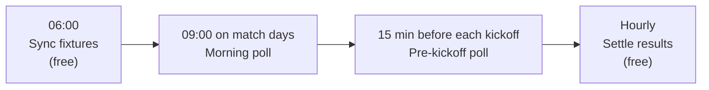
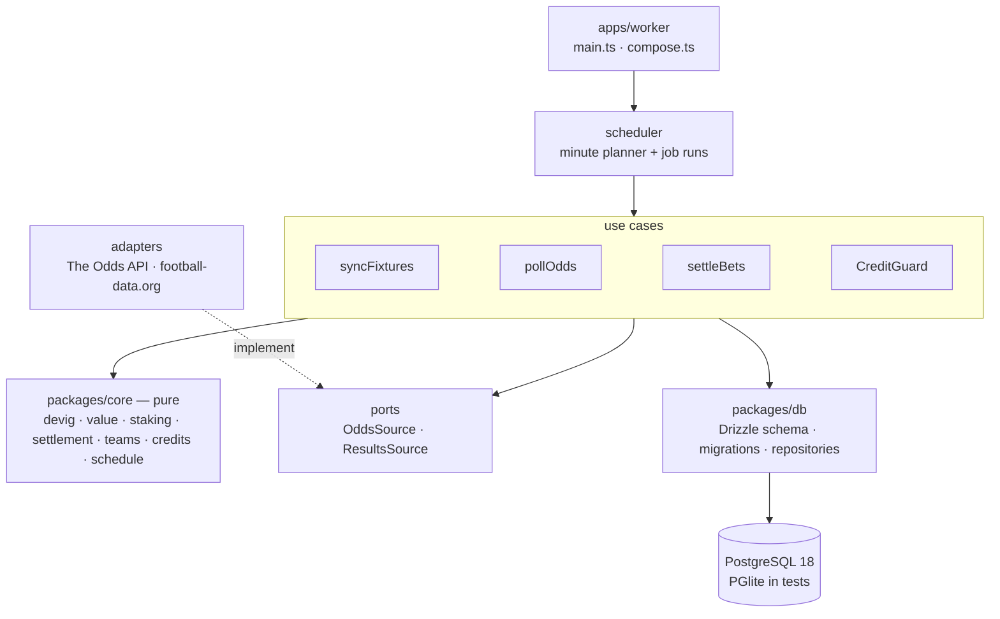

# Closing Line

[](https://github.com/achref-thamri/closing-line/actions/workflows/ci.yml)

A paper-betting system for European football that answers one question with data: **can a value scanner, and
later a human expert, beat the bookmakers?** Every player bets virtual money, and every bet is measured against the
closing line, the market's most accurate price. Real money only follows a track record that clears rules fixed in
advance.


_The dashboard running on its built-in demo data (`pnpm --filter @closing-line/web dev`)._

## Highlights

- **Market-based value detection.** Pinnacle's prices, with the margin removed by the power method, are the fair
  reference. The scanner backs any bookmaker price that beats it by 3% or more, after exchange commission.
- **Measured against the closing line.** Each bet records the fair closing price and its closing line value (CLV),
  the standard skill signal that profit alone cannot give over a few hundred bets.
- **A benchmark that cannot be gamed.** An "always back the favourite" player bets every match at the same moment,
  so a strategy has to beat something simple, not just break even.
- **Never runs out of free credits.** A credit guard spreads the monthly API quota over the days left, keeps a
  reserve, warns at 70% and 90%, and pauses instead of failing when the quota is used up.
- **Correct by construction.** One bet per player and selection (a unique index), settlement only of open bets,
  jobs that run at most once and never late, money in integer øre, and check constraints for data that must never
  exist.
- **Tested at every level.** Property-based tests for the maths, use cases on a real Postgres engine in-process
  (PGlite), adapters against recorded API responses, a CI job on Postgres 18, and a Docker smoke test that boots
  the whole stack.

## How it works



1. **Sync** stores the coming fixtures from The Odds API.
2. **Each poll** fetches match-result odds from ten bookmakers in one call, stores every price, and lets the scanner
   bet on value with quarter-Kelly stakes.
3. **The pre-kickoff poll** also records the fair closing price and CLV of every open bet, and places the
   favourite benchmark bet.
4. **Settlement** matches fixtures to football-data.org results by kickoff and team names, which differ between the
   sources, and settles bets on the regular-time score. Matches called off for 48 hours are void.

Notifications (value bets, settlements, credit warnings, failed jobs, a weekly report) go to Telegram. A
dashboard shows the leaderboard, each player's bankroll over time and the latest bets.

| Player        | Bets on                                                                    |
| ------------- | -------------------------------------------------------------------------- |
| Value scanner | Any price at least 3% above Pinnacle's fair price; pauses after a bad week |
| Favourite     | Pinnacle's favourite in every match, flat stake (benchmark)                |
| Friend        | Phase 2: his own bets from Telegram, with his price and reasons            |
| Friend + scan | Phase 2: the friend's bets that the scanner also rates as value            |

## Architecture



```
apps/worker/      jobs, adapters, use cases, scheduler, entry point
apps/web/         Next.js dashboard (server components read the database; demo data without one)
packages/core/    pure betting maths and rules, no I/O
packages/db/      Drizzle schema, SQL migrations, repositories
packages/config/  zod-validated settings and secrets
docs/adr/         architecture decision records
docker/           Dockerfile and backup script
```

Dependencies point inward: `core` imports nothing, use cases reach vendors only through ports, and only adapters
know vendor APIs. Decisions and their trade-offs are in [docs/adr](docs/adr/).

## Tech stack

TypeScript (strict, ESM, erasable syntax only) on Node 24 · pnpm workspaces + Turborepo · PostgreSQL 18 + Drizzle
ORM · PGlite · zod · pino · Next.js (App Router, server components) · Tailwind CSS · Recharts · Vitest + fast-check
· Playwright · ESLint (typescript-eslint strict) · Prettier · husky + lint-staged · Docker Compose · GitHub Actions.

Node runs the TypeScript sources directly, so there is no build step: the container runs exactly what was tested.

## Getting started

Requirements: Node 24 (`.nvmrc`) and pnpm (via Corepack). No Docker needed locally: without `DATABASE_URL` the
worker uses an embedded PGlite database.

```sh
pnpm install
pnpm check                       # format, lint, typecheck, tests
cp .env.example .env             # add the API keys
node --env-file=.env apps/worker/src/main.ts
```

Dashboard with demo data (no database or keys needed):

```sh
pnpm --filter @closing-line/web dev   # http://localhost:3300
```

| Script                                       | What it does                                   |
| -------------------------------------------- | ---------------------------------------------- |
| `pnpm check`                                 | Everything CI runs, except Postgres and Docker |
| `pnpm test:coverage`                         | Tests with a coverage report and thresholds    |
| `pnpm --filter @closing-line/db db:generate` | SQL migration from schema changes              |

Settings (leagues, bookmakers, thresholds, stakes, credit reserve) have defaults in
`packages/config/src/schema.ts` and can be overridden with a JSON file via `CONFIG_PATH`.

## Deployment

Docker Compose runs Postgres 18, the worker, the dashboard and a nightly `pg_dump` (14 days kept) on a small VPS.
The dashboard listens on the server's loopback only and opens through an SSH tunnel:

```sh
ssh -N -L 3300:localhost:3000 <server>   # then http://localhost:3300
```

`docker/check-backup.sh` proves a backup restores: it loads the newest dump into a scratch database and compares
row counts with the live one (`docker compose exec -T backup sh -s < docker/check-backup.sh`).

Merges to `main`
deploy after CI passes ([deploy.yml](.github/workflows/deploy.yml)): GitHub Actions streams the tree over SSH with
a key that can only run [server-deploy.sh](scripts/server-deploy.sh), which unpacks aside, rebuilds and fails the
deploy unless the worker reports healthy within three minutes.

## Status

Phase 1 (scanner, benchmark, settlement) runs on the Premier League with the free API plans. Next: the friend's
Telegram bet flow, a dashboard, and more leagues. A player qualifies for real money only after at least 300 settled
bets over at least three months, with positive average CLV, a better ROI than the favourite benchmark, and a
drawdown under 30%.

Not betting advice. This is a personal project.

## License

[MIT](LICENSE)
