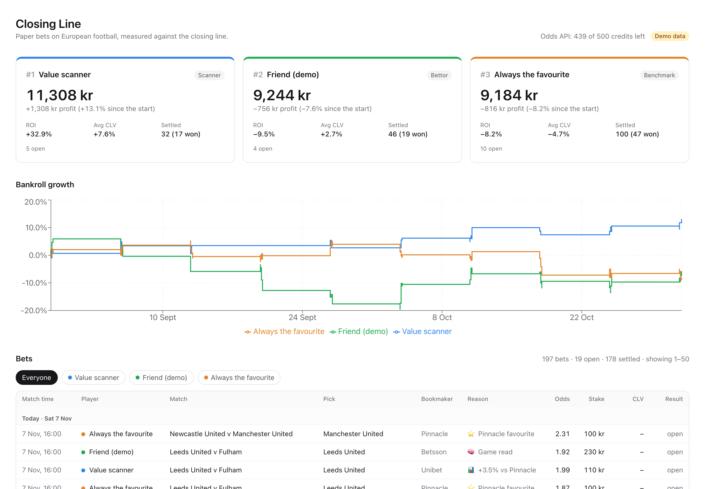
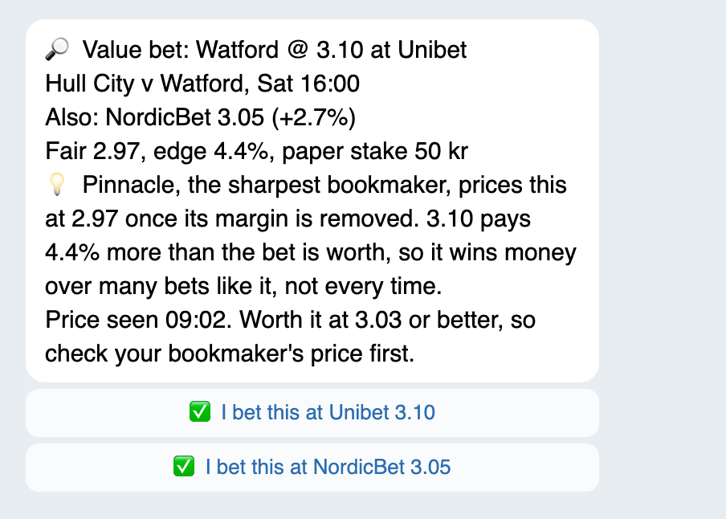
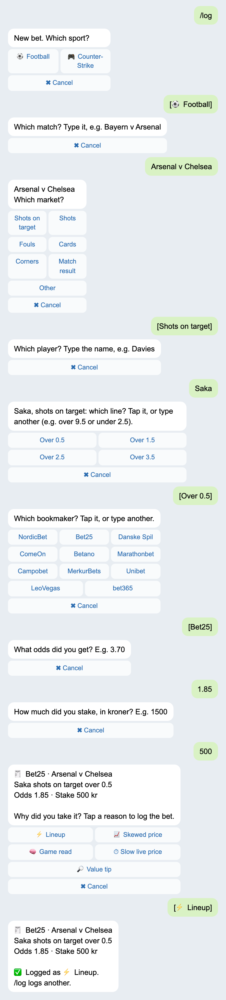
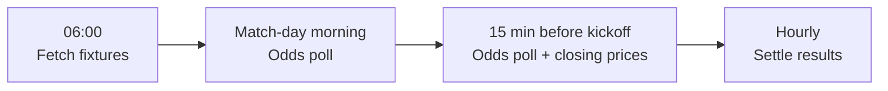

# Closing Line

[](https://github.com/achref-thamri/closing-line/actions/workflows/ci.yml)

Can a program, or a good bettor, beat the bookmakers? Closing Line tests that on European football with paper money.
It looks for bookmakers that pay more than a bet is worth, sends those bets as tips on Telegram, lets people log
their own bets, and measures everyone the same way. Real money comes only after a long track record.



<p>
  
  
</p>

_The dashboard, a tip and a logged bet, all on demo data._

## The idea

Pinnacle is the sharpest bookmaker, so its odds with its margin taken off are treated as the fair price. When
another bookmaker pays at least 2% more than that, the scanner bets and sends a tip.

Whether one bet wins is mostly luck, so bets are judged by closing line value (CLV): did you get a better price than
the market's last one before kickoff? Over a few hundred bets, positive CLV is the best sign of real skill. A player
also has to beat a simple benchmark that backs the favourite in every match.

[How it works](docs/how-it-works.md) follows one bet from the odds to the stake and the CLV, with real numbers.

| Player        | Bets on                                                                    |
| ------------- | -------------------------------------------------------------------------- |
| Value scanner | Any price at least 2% above the fair price; pauses after a bad week        |
| Favourite     | Pinnacle's favourite in every match, flat stake (the benchmark)            |
| Bettors       | Their own real bets, logged on Telegram, from a tip or their own judgement |

## What happens each day



- Each odds poll reads nine bookmakers in one call. The scanner bets on value and sends a tip with the lowest price
  still worth taking. If a later poll finds no bookmaker paying the fair price any more, everyone who got the tip
  hears that the price has gone.
- Just before kickoff, every open match-result bet gets its CLV, and the benchmark places its bet.
- Finished matches settle within the hour.

## On Telegram

| Command  | What it does                                                      |
| -------- | ----------------------------------------------------------------- |
| `/log`   | Log a bet, one question at a time, with buttons for known answers |
| `/open`  | Settle an open bet, cash-outs included                            |
| `/undo`  | Delete your last bet while it is open                             |
| `/picks` | The best prices above fair for the coming week                    |

Telegram also gets tips with an "I bet this" button per bookmaker, a morning reminder of open bets, and a Monday
report with everyone's results and a lesson of the week.

## Running it

Needs Node 24 and pnpm. No Docker or database needed locally.

```sh
corepack enable
pnpm install
pnpm check                             # format, lint, typecheck, tests
pnpm --filter @closing-line/web dev    # dashboard on demo data, http://localhost:3300
```

To run Closing Line itself, copy `.env.example` to `.env`, add four free keys and start
`node --env-file=.env apps/worker/src/main.ts`. [Running and deploying](docs/operations.md) says where to get the
keys, how to pick bookmakers outside Denmark, and how to host it on your own server.

## Status

Live since 1 November 2026 on the Premier League, Championship, Bundesliga, La Liga, Serie A and Ligue 1, on free
data plans. A player qualifies for real money only after 300 settled bets over at least three months, with positive
average CLV, a better ROI than the favourite benchmark, and a drawdown under 30%.

## More

- [How it works](docs/how-it-works.md): the maths of one bet
- [Architecture](docs/architecture.md): code layout, tech stack and tests
- [Running and deploying](docs/operations.md): settings, the back-test, deployment and backups
- [Decision records](docs/adr/): why things are built the way they are

Not betting advice. This is a personal project, under the [MIT license](LICENSE).
