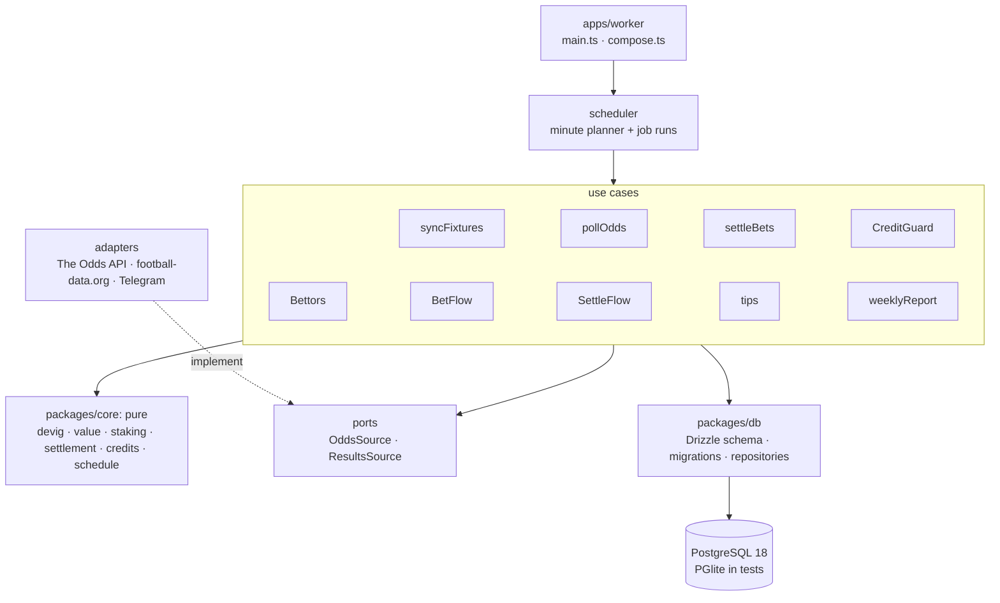

# Architecture

One worker process runs the jobs and the Telegram bot. A Next.js dashboard reads the same Postgres database.



```
apps/worker/      jobs, Telegram flows, adapters, use cases, scheduler, entry point
apps/web/         Next.js dashboard (server components read the database; demo data without one)
apps/backtest/    replays the scanner on past seasons (command line)
packages/core/    pure betting maths and rules, no I/O
packages/db/      Drizzle schema, SQL migrations, repositories
packages/config/  zod-validated settings and secrets
docs/adr/         architecture decision records
docker/           Dockerfiles and backup scripts
```

Dependencies point inward. `core` imports nothing, use cases reach vendors only through ports, and only adapters
know vendor APIs. `compose.ts` is the one place that builds the adapters and wires them into the jobs and the
Telegram flows; `main.ts` only starts and stops the result.

## Jobs

Every minute the worker asks a pure function which jobs are due, from the clock and the stored fixtures
([ADR 0001](adr/0001-schedule-with-a-minute-planner.md)). Each job has a window and a unique key, claimed in the
database before it runs, so a job runs at most once and never late, even across restarts.

The Odds API's free plan has 500 credits a month. Every paid call goes through a credit guard that spreads them over
the days left, keeps a reserve, warns at 70% and 90%, and pauses when they run out
([ADR 0004](adr/0004-credit-guard.md)).

## Data

The database refuses data that shouldn't exist: automated players get one bet per selection (a unique index), only
open bets settle, money is integer øre, and check constraints cover the rest. Every scanner decision is stored,
passes included ([ADR 0010](adr/0010-record-every-decision.md)), and a half-entered Telegram bet survives a restart
([ADR 0009](adr/0009-chat-state-in-the-database.md)).

## Tests

The maths has property-based tests (fast-check). Use cases run against a real Postgres engine in-process (PGlite),
adapters against recorded API responses, and CI runs the repositories again on Postgres 18. A Playwright test drives
the dashboard, and a Docker smoke test boots the whole stack.

## Tech stack

TypeScript (strict, ESM, erasable syntax only) on Node 24 · pnpm workspaces + Turborepo · PostgreSQL 18 + Drizzle
ORM · PGlite · zod · pino · grammY · Next.js (App Router, server components) · Tailwind CSS · Recharts · Vitest +
fast-check · Playwright · ESLint (typescript-eslint strict) · Prettier · husky + lint-staged · Docker Compose ·
GitHub Actions.

Node runs the TypeScript sources directly, so there is no build step and the container runs exactly what was tested
([ADR 0005](adr/0005-typescript-without-a-build-step.md)).
